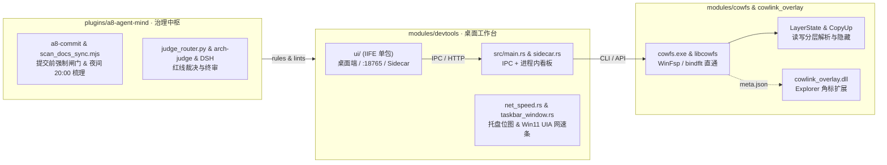

# a8-devtools 仓库大地图与全局文档索引 (AGENTS.md)

> **系统定位**：面向 Windows 的高性能开发者百宝箱平台（a8-devtools）。采用多模块 Cargo Workspace 架构，内嵌纯白桌面工作台，集成 WinFsp 写时复制文件系统（`cowfs`）、Explorer 角标扩展（`cowlink_overlay`）及通用智能体治理插件（`a8-agent-mind`）。
> **两级查找与渐进式加载准则**：查找模块、代码或文档时，先查本仓 `AGENTS.md`、共享 [项目术语表](docs/glossary.md) 与 [验证地图](docs/verify.md)，并按需阅读命中的 `docs/evergreen/` 常青文档（仅在深挖历史背景或排障细节时顺回链打开 `docs/records/`）；跨仓库资源请查全局仓库地图（[`plugins/a8-agent-mind/repos.md`](file:///e:/a8-devtools/plugins/a8-agent-mind/repos.md) / `%USERPROFILE%/.gemini/config/plugins/a8-agent-mind/repos.md`）。

---

## 一、系统架构大地图 (Architecture Map)

---

## 二、模块划分与代码映射 (Modules & Mapping)

| 模块名称 | 职责定位 | 源码目录 | 核心产物 | 依赖与特性 |
| :--- | :--- | :--- | :--- | :--- |
| **工作台主程序** (`modules/devtools`) | Tauri 2.0 桌面工作台、任务栏透明网速条、Hosts 维护、Doctor 诊断、进程内 `:18765` 看板、Git 代码审核与 Grok 提案联动 | [`modules/devtools/`](file:///e:/a8-devtools/modules/devtools/) | `a8-devtools.exe` | `tauri = "2"`, `rfd`, `cowfs`, `windows` |
| **写时复制文件系统** (`modules/cowfs`) | WinFsp 虚拟驱动、COW 状态机、原子 Copy-Up、源内 `.cowdiff` 自完整存储、`bindflt` 纯直通与服务自检 | [`modules/cowfs/`](file:///e:/a8-devtools/modules/cowfs/) | `cowfs.exe` & `libcowfs` | `winfsp`, `dashmap`, `parking_lot` |
| **桌面角标扩展** (`modules/cowlink_overlay`) | 基于 `IShellIconOverlayIdentifier` 的零侵入 Explorer 左下角 `>_` 徽章 COM DLL（内嵌图标与 1.5s TTL 缓存） | [`modules/cowlink_overlay/`](file:///e:/a8-devtools/modules/cowlink_overlay/) | `cowlink_overlay.dll` | `windows`, `serde_json` |
| **心智治理与复盘插件** (`plugins/a8-agent-mind`) | 通用 Antigravity 架构与文档治理插件（严控 9 大核心技能：3 自动内功 + 6 手动大招）：自动内功 `a8-workflow`（精简研发主线总控与 5 份场景指南）、`a8-judge`（Google Decisions API + `arch-judge`）、`a8-ui-design`；手动大招 `/a8-prompt`（事前提示词深化重写）、`/a8-dsh-review`（`dsh-reviewer` 终审）、`/a8-ui-verify`、`/a8-trace`（开发决策过程 TSV 账本）、`/a8-commit`（提交前强制红线审查、文档收口与标准化中文推送）、`/a8-improve`；配合夜间 20:00 `scan_docs_sync.mjs` / `docs-sync` 常青全量梳理、Sidecar 看板与 `mind-rules.md` | [`plugins/a8-agent-mind/`](file:///e:/a8-devtools/plugins/a8-agent-mind/) | `a8-agent-mind` (Antigravity Plugin) | `Google Decisions API`, `DeepSeek Harness`, `Generative UI`, `bindflt` |
| **统一脚本与门禁** (`scripts/` & 根目录) | WinFsp 静默安装、一键发布打包 (`release.mjs` / `release.bat`)、多模式启动脚本及 `scripts/lints/` 机械防线 | [`scripts/`](file:///e:/a8-devtools/scripts/), [`start.bat`](file:///e:/a8-devtools/start.bat), [`release.bat`](file:///e:/a8-devtools/release.bat) | 启动、打包与机械检查脚本 | Win32 / Node.js ESM / Python 标库 |

---

## 三、核心常青文档索引表 (Evergreen Docs Index)

> **双层渐进式防截断与术语表规范**：常青文档与工作记录共用 [项目术语表 (`docs/glossary.md`)](docs/glossary.md)（不在术语表中的非通用概念，要么补入术语表、要么用普通话直接写清）。此处直接挂接根级共享契约（`docs/glossary.md`、`docs/verify.md`）与按域整理的常青文档（`docs/evergreen/`，单文件均严控 `< 20,000 B` 防 Antigravity `24 KB` 截断）；各常青文档内部按需以回链指向关键工作记录（`docs/records/`）。

| 文档路径 | 类型 | 域/模块 | 关联源码 | 核心用途 |
| :--- | :--- | :--- | :--- | :--- |
| [项目术语表](docs/glossary.md) | GLOSSARY | 全仓共享术语 | 全仓库 | 常青文档与工作记录共用的项目专有概念普通话定义（写文档前先对齐） |
| [验证地图](docs/verify.md) | VERIFY | 真实验证路由 | `scripts/`, `modules/`, `plugins/a8-agent-mind/` | 改动模块→必跑验证面路由、D1~D6 实机执行卡物理判据与本地环境盲区清单 |
| [AI-研发工作流可视化指南.html](docs/evergreen/AI-研发工作流可视化指南.html) | VISUAL | 可视化总览 | `plugins/a8-agent-mind/`, `docs/` | 面向使用者的纯矢量图解指南：6 步双泳道、场景分流、9 大核心技能矩阵、快慢双轨与 5 级防错阶梯 |
| [平台架构与存储引擎](docs/evergreen/platform-and-storage.md) | EVERGREEN | 存储与桌面集成 | `Cargo.toml`, `modules/cowfs/`, `modules/cowlink_overlay/` | Cargo Workspace 单向分层、`.cowdiff` 存储与状态机、零重入与 `bindflt` 角标契约 |
| [桌面工作台与网速引擎](docs/evergreen/desktop-tray-and-settings.md) | EVERGREEN | 桌面工作台 | `modules/devtools/src/main.rs`, `modules/devtools/src/net_speed.rs`, `modules/devtools/src/taskbar_window.rs`, `modules/devtools/src/settings.rs`, `modules/devtools/src/sidecar.rs` | Win32 零黑窗、单实例唤醒、网速采集、Win11 UIA 网速条与开机自启设置 |
| [三端看板与研发工作流](docs/evergreen/dashboard-and-workflows.md) | EVERGREEN | 工作台与插件看板 | `modules/devtools/web/`, `modules/devtools/ui/`, `modules/devtools/src/agent_mind.rs`, `modules/devtools/src/sidecar.rs`, `plugins/a8-agent-mind/sidecars/panel/main.mjs` | 三端同源 IIFE 构建与防白屏不变量、Origin/Token 边界、代码审核与 Grok 提案联动 |
| [A8 Agent Mind 治理与插件](docs/evergreen/agent-mind-governance.md) | EVERGREEN | 插件与治理 | `plugins/a8-agent-mind/`, `scripts/lints/` | 5 级防线阶梯、`a8-workflow`、`/a8-commit` 提交前强制红线与文档闸门、夜间 20:00 `scan_docs_sync.mjs` / `docs-sync`、DSH 与仓库门禁 |

---

## 四、开发与质量交付红线 (Gatekeeper Constraints)

1. **零黑窗原则 (Zero Console Flashing)**：
   - 严禁调用 `cmd.exe`、`powershell.exe`、`sc.exe`、`taskkill.exe` 探测或关闭进程；
   - 全链路采用原生 Win32 API（`windows` crate）或 `CREATE_NO_WINDOW`（`0x08000000`）执行后台工具调用。
2. **多模块强隔离与自闭环原则**：
   - `modules/cowfs` 必须保持无 GUI 依赖（纯系统内核），可独立测试与 CLI 分发；
   - `modules/devtools` 作为消费层只通过 `cowfs` 公开接口协同，严禁反向污染。
3. **驱动隔离与死锁免疫原则 (Zero Re-entrancy)**：
   - 物理存储层（Upper/Lower）绝对不能位于虚拟挂载点（Mount Point）内部；
   - 虚拟文件系统必须在解析层与遍历层对 `.cowdiff` 和 `.cowlink` 执行根级静默过滤，禁止工作区透视自身增量。
4. **双层文档、术语表与验证交卷门槛**：
   - **双层文档、验证地图与术语表**：普通小改靠单测与行内注释；重大变更写 `docs/records/` 后直接在当前上下文顺手轻更新 `docs/evergreen/`、`docs/verify.md` 与 `AGENTS.md`（勿额外起 `docs-sync` 子代理），全量对齐交由每晚 20:00 定时任务梳理补齐（`docs/` 根目录仅允许 `glossary.md` 与 `verify.md`）；文档写作遵循术语表二选一原则（不在 [`docs/glossary.md`](docs/glossary.md) 中的非通用概念，要么补入术语表并用普通话讲清，要么在正文直接用普通话解释）；
   - **真实验证面路由（禁止假绿交卷）**：严禁仅凭 `cargo check`、Vite 开发模式或 Mock 测试绿灯宣布完成；改动对应模块须对照 [验证地图](docs/verify.md) 跑通 D1~D6 对应真实运行表面并附第一现场实证；
   - **Rust 门禁**：`cargo test --workspace` 与 `cargo check --workspace` 全绿；
   - **前端与结构门禁**：`modules/devtools/web` 执行 `npm run build`（`tsc -b && vite build`）；根目录执行 `node scripts/lints/check_swallowed_exceptions.mjs`、`node scripts/lints/check_workspace_hygiene.mjs`、`node scripts/lints/check_work_records.mjs` 与 `py -3 scripts/lints/check_plugin_agents.py` 全绿通过。
