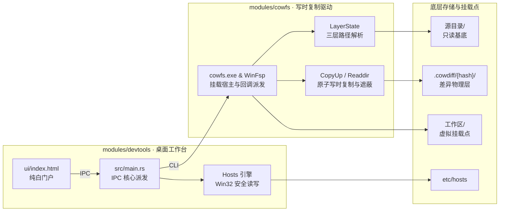

# a8-devtools 仓库大地图与全局文档索引 (AGENTS.md)

> **系统定位**：面向 Windows 的高性能开发者百宝箱平台（a8-devtools）。采用与大型工程（如 `e:\a8-turbo`）一致的多模块工作空间架构（Cargo Workspace），内嵌高颜值纯白桌面工作台，并首发集成自主研发的 WinFsp 写时复制文件系统（`cowfs`）与本机 Hosts 维护等多元开发能力。
> **仓库大地图与两级查找准则**：本文件为本仓库的**仓库大地图 (`AGENTS.md`)**。查找任何模块、代码、脚本或文档时，**请先从本仓库大地图中查找**；若发现所找内容不属于本仓库（如其他仓库的模块、服务、文档、Demo 或测试靶场），请**优先从全局仓库地图（[`plugins/a8-agent-mind/repos.md`](file:///e:/a8-devtools/plugins/a8-agent-mind/repos.md) / 全局挂载 `%USERPROFILE%/.gemini/config/plugins/a8-agent-mind/repos.md`）中根据索引查找定位**。

---

## 一、系统架构大地图 (Architecture Map)

---

## 二、模块划分与代码映射 (Modules & Mapping)

| 模块名称 | 职责定位 | 源码目录 | 核心产物 | 依赖与特性 |
| :--- | :--- | :--- | :--- | :--- |
| **工作台主程序** (`modules/devtools`) | Tauri 2.0 桌面端百宝箱门户、系统托盘动态网速渲染、Win32 网速采集、Hosts 编辑与 Doctor 检测 | [`modules/devtools/`](file:///e:/a8-devtools/modules/devtools/) | `a8-devtools.exe` (~9.2MB) | `tauri = "2"`, `rfd`, `cowfs`, `windows` |
| **写时复制文件系统** (`modules/cowfs`) | WinFsp 虚拟驱动集成、COW 状态机、原子 Copy-Up、源内 `.cowdiff` 自完整存储、`bindflt` 直通与注册辅助 | [`modules/cowfs/`](file:///e:/a8-devtools/modules/cowfs/) | `cowfs.exe` & `libcowfs` | `winfsp`, `dashmap`, `parking_lot` |
| **桌面角标扩展** (`modules/cowlink_overlay`) | 基于 `IShellIconOverlayIdentifier` 的零侵入文件夹左下角徽章 COM DLL（内嵌透明角标与 TTL 缓存） | [`modules/cowlink_overlay/`](file:///e:/a8-devtools/modules/cowlink_overlay/) | `cowlink_overlay.dll` | `windows`, `serde_json` |
| **心智治理与复盘插件** (`plugins/a8-agent-mind`) | 通用 Antigravity 架构治理心智插件：包含 `Stop` Hook 自动反射与 `docs/` 严格门禁 (`hooks.json` + `stop_reflect.py`，支持 `AUTO_LINT`、`ASK_USER_UI` 与 `DOCS_MAINTENANCE`)、Google Decisions API 语义裁判 (`a8-judge`)、`harness_metrics.jsonl` 遥测账本、DSH 极速有界终审闭环 (`a8-dsh-review` 默认 `medium` + 预打包 diff)、统一规则沉淀与清理 (`/a8-improve`)、独立 UI 端到端验证 (`/a8-ui-verify`)、极简 UI 原则 (`a8-ui-polish`)、三端同源看板（含「可观测」ECharts 图表与提案状态闭环）及含显式状态机红线的 `mind-rules.md` | [`plugins/a8-agent-mind/`](file:///e:/a8-devtools/plugins/a8-agent-mind/) | `a8-agent-mind` (Antigravity Plugin) | `Google Decisions API`, `DeepSeek Harness`, `Generative UI`, `bindflt` |
| **统一脚本与引导** (`scripts/` & 根目录) | WinFsp 驱动静默安装与多模式启动脚本 | [`scripts/`](file:///e:/a8-devtools/scripts/), [`start.bat`](file:///e:/a8-devtools/start.bat) | 启动批处理与自动化脚本 | 纯 Win32 / PowerShell 原生调用 |

---

## 三、核心架构文档索引表 (Core Architecture Index)

> **双层索引防截断规范**：此处仅保留核心 `SPEC`/`ADR` 简述（单文件严控 `< 20,000 B` 防触及 `24 KB` 截断红线）。**全量文档与 `BUG` 复盘清单见 [`docs/INDEX.md`](docs/INDEX.md)。**

| 文档路径 | 类型 | 模块 | 核心用途 |
| :--- | :--- | :--- | :--- |
| [20261116-SPEC-工作台与插件看板-提交前GitDiff人工代码审核工作台设计.md](docs/20261116-SPEC-工作台与插件看板-提交前GitDiff人工代码审核工作台设计.md) | SPEC | 工作台与插件看板 | 独立「代码审核」一级入口、Git Diff 契约与批注反馈闭环 |
| [20261115-SPEC-工作台与插件看板-Grok每日AI提案面板与Antigravity联动契约.md](docs/20261115-SPEC-工作台与插件看板-Grok每日AI提案面板与Antigravity联动契约.md) | SPEC | 工作台与插件看板 | Grok 每日提案 4 态流转与 Antigravity 联动唤醒 |
| [20261113-ADR-存储与桌面集成-纯直通透明映射与ShellOverlay角标架构.md](docs/20261113-ADR-存储与桌面集成-纯直通透明映射与ShellOverlay角标架构.md) | ADR | 存储与桌面集成 | 纯 `bindflt` 透明直通与 Shell Overlay 内嵌角标 |
| [20261110-SPEC-插件与治理-基于GoogleDecisionsAPI的语义红线裁判与规则沉淀设计.md](docs/20261110-SPEC-插件与治理-基于GoogleDecisionsAPI的语义红线裁判与规则沉淀设计.md) | SPEC | 插件与治理 | `a8-agent-mind` 三层治理、无损决策、DSH 与可观测面板 |
| [20261108-SPEC-工作台模块-Windows任务栏托盘与实时网速监控引擎.md](docs/20261108-SPEC-工作台模块-Windows任务栏托盘与实时网速监控引擎.md) | SPEC | 工作台模块 | Win32 网速采集、Win11 托盘悬浮条与 `:18765` 看板 |
| [20261022-SPEC-存储引擎-自完整差异存储与虚拟化架构.md](docs/20261022-SPEC-存储引擎-自完整差异存储与虚拟化架构.md) | SPEC | 存储引擎 | `.cowdiff/{pathHash}` 自完整存储与重入死锁防御 |
| [20261022-ADR-架构演进-a8-devtools多模块工作台与cowfs集成.md](docs/20261022-ADR-架构演进-a8-devtools多模块工作台与cowfs集成.md) | ADR | 平台底座 | `a8-devtools` 多模块 Cargo Workspace 演进决策 |

---

## 四、开发与质量交付红线 (Gatekeeper Constraints)

1. **零黑窗原则 (Zero Console Flashing)**：
   - 严禁调用 `cmd.exe`、`powershell.exe`、`sc.exe`、`taskkill.exe` 等命令行工具探测或关闭进程；
   - 必须全链路采用原生 Win32 API (`windows` crate) 操作 SCM 服务与进程。
2. **多模块强隔离与自闭环原则**：
   - `modules/cowfs` 必须保持无 GUI 依赖（纯系统内核），可独立进行极速单体测试与 CLI 分发；
   - `modules/devtools` 作为消费层，只通过 `cowfs` 公开接口进行业务协同，严禁跨模块反向污染。
3. **驱动隔离与死锁免疫原则 (Zero Re-entrancy)**：
   - 物理存储层（Upper/Lower）绝对不能位于虚拟挂载点（Mount Point）内部；
   - 虚拟文件系统必须在解析层与遍历层对 `.cowdiff` 和 `.cowlink` 执行根级静默过滤，禁止工作区透视自身增量。
4. **验证交卷门槛**：
   - Rust 门禁：提交前执行 `cargo test --workspace`（当前 `cowfs` 4 项单测 + 7 项单元测试 + 1 项 WinFsp 集成探测 + `a8_devtools` 13 项单测，共 25 项全绿）及 `cargo check --workspace`；
   - 前端与结构门禁：`modules/devtools/web` 执行 `npm run build`（`tsc -b && vite build`）；根目录执行 `node scripts/lints/check_swallowed_exceptions.mjs`、`node scripts/lints/check_workspace_hygiene.mjs` 与 `py -3 scripts/lints/check_plugin_agents.py` 全绿通过。
