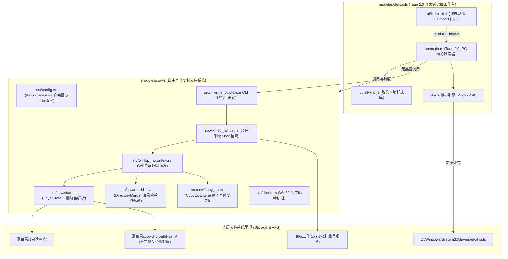

# a8-devtools 架构大地图与全局文档索引 (AGENTS.md)

> **系统定位**：面向 Windows 的高性能开发者百宝箱平台（a8-devtools）。采用与大型工程（如 `e:\a8-turbo`）一致的多模块工作空间架构（Cargo Workspace），内嵌高颜值纯白桌面工作台，并首发集成自主研发的 WinFsp 写时复制文件系统（`cowfs`）与本机 Hosts 维护等多元开发能力。

---

## 一、系统架构大地图 (Architecture Map)

---

## 二、模块划分与代码映射 (Modules & Mapping)

| 模块名称 | 职责定位 | 源码目录 | 核心产物 | 依赖与特性 |
| :--- | :--- | :--- | :--- | :--- |
| **工作台主程序** (`modules/devtools`) | Tauri 2.0 桌面端百宝箱门户、系统托盘动态网速渲染、Win32 网速采集、Hosts 编辑与 Doctor 检测 | [`modules/devtools/`](file:///e:/a8-devtools/modules/devtools/) | `a8-devtools.exe` (~9.2MB) | `tauri = "2"`, `rfd`, `cowfs`, `windows` |
| **写时复制文件系统** (`modules/cowfs`) | WinFsp 虚拟驱动集成、COW 状态机、原子 Copy-Up、源内 `.cowdiff` 自完整存储 | [`modules/cowfs/`](file:///e:/a8-devtools/modules/cowfs/) | `cowfs.exe` (~0.9MB) & `libcowfs` | `winfsp`, `dashmap`, `parking_lot` |
| **语义架构裁判插件** (`plugins/arch-judge`) | 通用 Antigravity 架构裁判插件，基于 Jev 结构化决策模型与两阶段调查模式，提供 4 大正交维度自适应路由与高质感 Generative UI 紧凑报表 | [`plugins/arch-judge/`](file:///e:/a8-devtools/plugins/arch-judge/) | `arch-judge` (Antigravity Plugin) | `Jev Schema`, `Generative UI`, `Antigravity SDK` |
| **统一脚本与引导** (`scripts/` & 根目录) | WinFsp 驱动静默安装与多模式启动脚本 | [`scripts/`](file:///e:/a8-devtools/scripts/), [`start.bat`](file:///e:/a8-devtools/start.bat) | 启动批处理与自动化脚本 | 纯 Win32 / PowerShell 原生调用 |

---

## 三、长期技术文档索引表 (Documentation Registry)

> **建档规则规范**：仅收录具备长期参考、架构设计或重大演进价值的有效文档。日常琐碎修补严禁立卷。

| 文档路径 | 文档类型 | 所属模块 | 当前状态 | 核心用途与摘要 | 关联源码/模块 |
| :--- | :--- | :--- | :--- | :--- | :--- |
| [`docs/20261110-SPEC-插件与治理-基于Jev架构的通用语义红线裁判设计与演进规范.md`](file:///e:/a8-devtools/docs/20261110-SPEC-插件与治理-基于Jev架构的通用语义红线裁判设计与演进规范.md) | SPEC | 插件与治理 | 实施已生效 | 规约基于 Jev 架构的通用架构红线裁判插件设计：两阶段调查流水线、4 大正交维度语法元特征路由、Generative UI 紧凑型高颜值报表与跨项目即插即用演进契约 | [`plugins/arch-judge/`](file:///e:/a8-devtools/plugins/arch-judge/) |
| [`docs/20261022-ADR-架构演进-a8-devtools多模块工作台与cowfs集成.md`](file:///e:/a8-devtools/docs/20261022-ADR-架构演进-a8-devtools多模块工作台与cowfs集成.md) | ADR | 平台底座 | 实施已生效 | 记录从单一 cowlink 演进为 a8-devtools 多模块工作区（对标 a8-turbo 结构）的战略决策 | [`Cargo.toml`](file:///e:/a8-devtools/Cargo.toml), [`modules/`](file:///e:/a8-devtools/modules/) |
| [`docs/20261022-SPEC-存储引擎-自完整差异存储与虚拟化架构.md`](file:///e:/a8-devtools/docs/20261022-SPEC-存储引擎-自完整差异存储与虚拟化架构.md) | SPEC | 存储引擎 | 实施已生效 | 规约源内 `.cowdiff/{pathHash}/` 自完整布局、C盘零占用、驱动重入死锁防御与根级遮蔽机制 | [`modules/cowfs/`](file:///e:/a8-devtools/modules/cowfs/) |
| [`docs/20261108-SPEC-工作台模块-Windows任务栏托盘与实时网速监控引擎.md`](file:///e:/a8-devtools/docs/20261108-SPEC-工作台模块-Windows任务栏托盘与实时网速监控引擎.md) | SPEC | 工作台模块 | 实施已生效 | 规约 Win32 IP Helper 无锁网速采集、任务栏原生实时网速悬浮条 (双缓冲 GDI 抗锯齿、全透明大字号、全屏智能隐藏避让)、托盘图标与事件总线同步 | [`modules/devtools/`](file:///e:/a8-devtools/modules/devtools/) |

---

## 四、开发与质量交付红线 (Gatekeeper Constraints)

1. **零黑窗原则 (Zero Console Flashing)**：
   - 严禁调用 `cmd.exe`、`powershell.exe`、`sc.exe`、`taskkill.exe` 等命令行工具探测或关闭进程；
   - 必须全链路采用原生 Win32 API (`windows` crate) 操作 SCM 服务与进程。
2. **多模块强隔离与自闭环原则**：
   - `modules/cowfs` 必须保持无 GUI 依赖（纯系统内核），可独立进行极速单体测试与 CLI 分发；
   - `modules/devtools` 作为消费层，只通过 `cowfs` 公开接口进行业务协同，严禁跨模块反向污染。
3. **驱动隔离与死锁免疫原则 (Zero Re-entrancy)**：
   - 物理存储层（Upper/Lower）绝对不能位于虚拟挂载点（Mount Point）内部；
   - 虚拟文件系统必须在解析层与遍历层对 `.cowdiff` 和 `.cowlink` 执行根级静默过滤，禁止工作区透视自身增量。
4. **验证交卷门槛**：
   - 提交前必须执行 `cargo test --workspace` 并确认 100% 通过（当前 7 项单元测试 + 2 项集成探测全绿）；
   - 执行 `cargo check --workspace` 确认零告警/编译通过。
