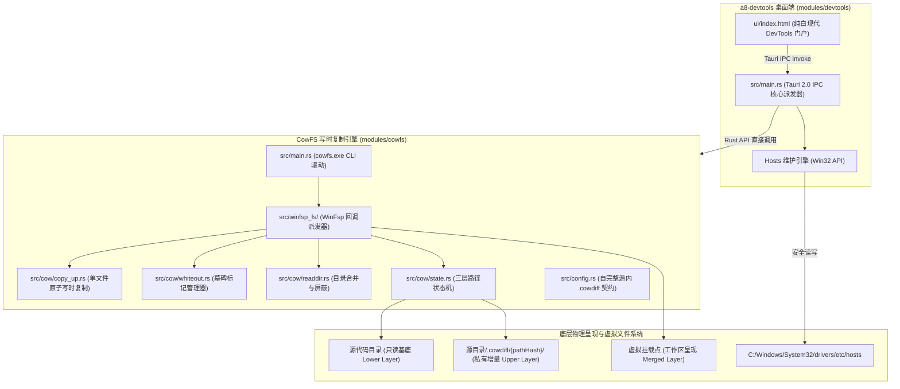

<div align="center">

# a8-devtools 🛠️

**面向 Windows 的高性能现代开发者百宝箱平台**

[](https://www.rust-lang.org/)
[](https://tauri.app/)
[](https://microsoft.com)
[](LICENSE)
[](https://winfsp.dev/)

<p align="center">
  <b>极速 · 轻量 · 纯粹 · 零黑窗</b><br>
  集成了自主研发的 WinFsp 写时复制文件系统（CowFS）、Hosts 原生维护与环境诊断等能力的开发者效率底座。
</p>

[功能亮点](#-核心功能矩阵) •
[系统架构](#-系统架构大地图) •
[快速开始](#-快速开始) •
[命令行指南](#-cowfs-命令行模式) •
[模块说明](#-模块架构划分) •
[参与贡献](#-参与贡献与开源协议)

</div>

---

## 🌟 核心功能矩阵

### 1. ⚡ 写时复制虚拟工作区 (`cowfs`)
专为**“基于同一份大型代码仓库并行派生多个独立开发分支”**场景设计：
- **秒级挂载 (< 0.5s)**：无论底层源码库是 10GB 还是 100GB，新建工作区耗时不足半秒，初始磁盘占用为 **0**；
- **源内自完整 `.cowdiff` 变体池**：差异数据物理持久化在源目录内部的 `.cowdiff/{pathHash}/`，支持单源码派生多个独立目标工作区；差异与源码同盘同速，**C 盘系统盘 0 物理占用**，支持整包随源码归档迁移；
- **白颜墓碑标记（Whiteout）**：工作区中删除源文件自动生成虚拟白颜标记，底层文件保持 0 污染，卸载或重新挂载后完整保留状态；
- **驱动级内核隔离与反穿透**：底层文件系统自动屏蔽 `.cowdiff` 自身，彻底杜绝工作区透视增量数据或引起递归死锁。

### 2. 🌐 Hosts 原生极速维护引擎
- **纯 Win32 API 驱动**：摒弃传统批处理、PowerShell 或 `sc.exe` 外部命令调度，全程零黑窗闪烁；
- **免提权平滑读写**：安全原子修改系统 `C:\Windows\System32\drivers\etc\hosts`；
- **极速环境切换**：支持本地开发、联调测试、生产镜像等配置方案秒级切换与 DNS 缓存原子刷新。

### 3. 🩺 驱动与运行环境原生诊断 (`Doctor`)
- 原生探测 WinFsp 用户态驱动与 SCM 服务状态；
- 支持内置安装包一键静默引导配置驱动，无需繁琐人工排错。

### 4. 🚀 Windows 任务栏托盘与实时网速监控
- **Win32 IP Helper 无锁极速采集**：直接调用 Windows 原生 `GetIfTable2`，排除回环网卡，CPU 占用低于 0.01%，无黑窗开销；
- **自研 3x5 微点阵无锯齿文字位图渲染**：动态在 32x32 托盘图标内渲染双行网速（上行琥珀橙 `▲`、下行天空蓝 `▼`），在 Windows 浅色/深色任务栏上均一眼即看，零外部字体依赖；
- **全生命周期防误退机制**：单击托盘图标一键快速显隐工作台，右上角关闭按钮拦截自动退回托盘后台静默运行；右键菜单提供当前吞吐看板与退出选项；
- **前后端事件总线实时联动**：Tauri 事件总线毫秒级同步速率数据至工作台顶部导航栏胶囊。

### 5. 🖥️ 极简极速桌面工作台 (Tauri 2.0)
- **单执行文件仅 ~9.2 MB**，驻留内存仅 **~36 MB**；
- 纯白现代 UI 设计，本地脱机静态资源加载，零网络依赖，秒级冷启动。

---

## 🏛️ 系统架构大地图



---

## 📁 存储规范：自完整 `.cowdiff` 布局

每个被链接的源码仓库根目录下，自动维护一个 `.cowdiff` 容器：

```text
E:\repo_root\
├── src/                          # 原始工程代码（只读基底，100% 零污染）
├── Cargo.toml
└── .cowdiff/                     # 变体存储池（支持多工作区物理隔离）
    ├── ws_feature_a_4f92c10a/    # 工作区 A（Slug + PathHash）
    │   ├── meta.json             # 自完整工作区元数据
    │   └── diff/                 # 物理增量文件层（Upper）
    │       ├── modified_app.rs   # 修改文件
    │       ├── new_feature.rs    # 新增文件
    │       └── .cow_deleted.xxx  # 白颜删除标记
    └── ws_bugfix_b_9a87bf12/     # 工作区 B（独立增量）
        ├── meta.json
        └── diff/
```

- **脱机自描述**：只要拷贝带 `.cowdiff` 的源目录至任意机器，即可秒级恢复所有工作区，无需任何中心化数据库。
- **全局索引双写**：本机在 `%LOCALAPPDATA%\cowlink\workspaces\` 保持轻量目录哈希索引，供 UI 和 CLI 秒级检索。

---

## 🚀 快速开始

### 运行环境要求
- **操作系统**：Windows 10 / Windows 11 (x64)
- **底层驱动**：[WinFsp](https://winfsp.dev/) 2023 或更新版本（本项目 `scripts/` 目录内置静默安装脚本）
- **开发构建**：Rust 1.80+（仅源码编译需要）

### 1. 一键启动
克隆仓库后，双击根目录批处理直接启动工作台：
- `start_gui.vbs`：**推荐**，静默无黑窗直接唤起桌面工作台；
- `start.bat`：控制台快速引导启动，自动诊断驱动并启动程序。

### 2. 源码构建
采用标准 Cargo Workspace 架构：

```powershell
# 1. 克隆代码仓库
git clone https://github.com/007slm/a8-devtools.git
cd a8-devtools

# 2. 运行自动化测试套件
cargo test --workspace

# 3. 编译发布版 (输出 a8-devtools.exe 与 cowfs.exe)
cargo build --release --workspace
```

编译产物位于 `target/release/`：
- `a8-devtools.exe` (~8.4 MB)：Tauri 2.0 桌面端主程序；
- `cowfs.exe` (~0.9 MB)：独立的文件系统命令行驱动程序。

---

## 💻 `cowfs` 命令行模式

如果你偏好终端或需要在 CI/CD 脚本中集成虚拟工作区能力，可直接使用 `cowfs.exe`：

```powershell
# 1. 运行系统驱动与环境诊断
cowfs doctor

# 2. 创建写时复制虚拟工作区 (自动在源内派生 .cowdiff)
cowfs link E:\BaseRepo E:\Workspaces\DevBranch

# 3. 查看当前工作区的差异统计 (修改/新增/删除)
cowfs status E:\Workspaces\DevBranch

# 4. 主动对指定文件执行脱钩写时复制
cowfs detach E:\Workspaces\DevBranch src/main.rs

# 5. 安全卸载工作区 (物理差异 100% 完整保存在源目录 .cowdiff 中)
cowfs unlink E:\Workspaces\DevBranch

# 6. 从历史差异中秒级恢复工作区
cowfs resume E:\BaseRepo E:\Workspaces\DevBranch
```

---

## 🧩 模块架构划分

| 模块路径 | 职责定位 | 核心产物 | 主要特性与技术栈 |
| :--- | :--- | :--- | :--- |
| [`modules/devtools`](modules/devtools) | Tauri 2.0 桌面端工作台 | `a8-devtools.exe` | 纯白极简 UI、Win32 API 原生 Hosts 读写、驱动状态诊断 |
| [`modules/cowfs`](modules/cowfs) | 写时复制核心引擎 & CLI | `cowfs.exe` / `libcowfs` | WinFsp 驱动绑定、原子 Copy-Up、自完整 `.cowdiff` 规范 |
| [`scripts`](scripts) | 自动化脚本与驱动包 | `install_driver.bat` 等 | WinFsp 离线静默安装与多模式引导支持 |

---

## 🤝 参与贡献与开源协议

本项目基于 **[MIT License](LICENSE)** 开源协议，欢迎提交 Issue 与 Pull Request。

### 代码红线与质量准则
1. **零黑窗原则 (Zero Console Flashing)**：必须通过原生 Win32 API 与系统交互，严禁弹出控制台黑窗；
2. **内核隔离原则**：虚拟文件系统挂载点禁止访问 `.cowdiff` 增量容器，杜绝重入死锁；
3. **提交门槛**：提交前必须通过 `cargo check --workspace`（0 告警）与 `cargo test --workspace`（100% 测试通过）。
