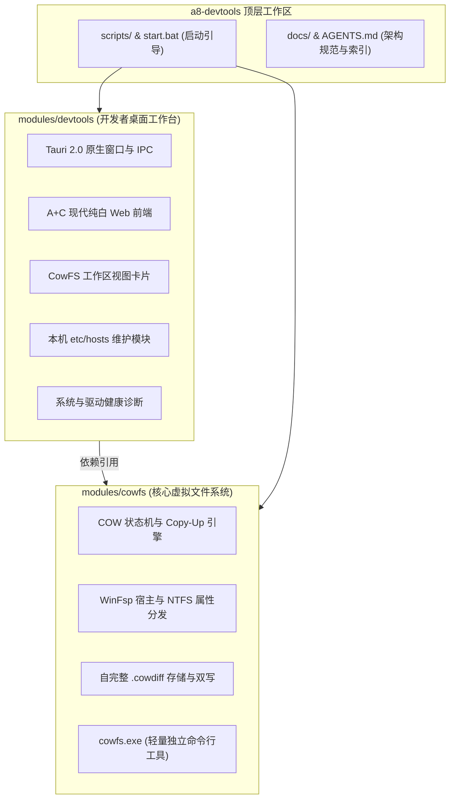

# a8-devtools 多模块工作台与 cowfs 集成架构演进决策 (ADR)

> **文档标识**：`20261022-ADR-架构演进-a8-devtools多模块工作台与cowfs集成.md`  
> **文档类型**：ADR（架构决策记录）  
> **所属模块**：平台底座 (Platform Architecture) & 工作台 (DevTools UI)  
> **决策状态**：ACCEPTED / 已落地生效  
> **最后更新**：2026-10-22  

---

## 一、背景与业务驱动 (Context)

最初项目被定位为单一功能的虚拟文件系统工具 `cowlink`。但随着研发场景深入与工程诉求扩展：
1. **工具链碎片化痛点**：Windows 开发者日常除了虚拟工作区派生外，还高频需要维护本机 `etc/hosts` 映射、排查本地端口与 DNS、诊断内核驱动等。各工具分散运行会导致心智负担重；
2. **多模块演化诉求**：项目全面升级定位为 **`a8-devtools`（A8 开发者百宝箱 / 开发者工作台）**；
3. **架构参考对齐**：目录结构全面参考大型微服务体系（如 `e:\a8-turbo`）的多模块规范（`modules/`），将系统级底层能力与百宝箱 UI 彻底解耦，为未来源源不断吸纳更多开发工具模块做好准备。

---

## 二、架构决策方案 (Decisions)

### 1. 采用 Rust 原生 Cargo Workspace 多模块工作空间
根目录定义统一工作区治理（`Cargo.toml`）：
```toml
[workspace]
members = [
    "modules/cowfs",
    "modules/devtools",
]
resolver = "2"
```

### 2. 模块职责与边界切分



- **`modules/cowfs`**：
  - **定位**：纯系统级文件系统库（`libcowfs`）与轻量原生命令行二进制（`cowfs.exe`）；
  - **解耦**：彻底剥离任何前端/UI 依赖（无 Tauri、无 RFD），构建与测试速度极快；
  - **职责**：WinFsp 驱动宿主、COW 状态机、原子 Copy-Up、三层目录合并、`.cowdiff` 源内自完整存储与元数据同步。
- **`modules/devtools`**：
  - **定位**：高颜值一体化桌面工作台应用（`a8-devtools.exe`）；
  - **架构**：Tauri 2.0 桌面外壳，上层承载多功能开发者卡片；
  - **集成能力**：
    1. **CowFS**：第一首发核心能力，无缝集成此前定稿的 A+C 融合视图；
    2. **Hosts 维护**：原生读写 `C:\Windows\System32\drivers\etc\hosts`，支持快捷预设与实时生效；
    3. **Doctor 诊断**：纯 Win32 API 驱动状态与特权检测；
    4. **未来插件点**：随时可在 `modules/` 下引入新模块并在 UI 中开辟新 Tab。

---

## 三、目录重构映射表 (Refactoring Parity)

| 重构前路径 | 重构后路径 | 说明 |
| :--- | :--- | :--- |
| `src/cow/`, `src/winfsp_fs/` | [`modules/cowfs/src/`](file:///e:/a8-devtools/modules/cowfs/src/) | 虚拟文件系统核心内核 |
| `src/main.rs`, `src/cli.rs` | [`modules/cowfs/src/main.rs`](file:///e:/a8-devtools/modules/cowfs/src/main.rs) | 独立编译生成 `cowfs.exe` CLI |
| `tests/` | [`modules/cowfs/tests/`](file:///e:/a8-devtools/modules/cowfs/tests/) | 5 项自动化驱动与单体测试迁移 |
| `src/gui_main.rs` | [`modules/devtools/src/main.rs`](file:///e:/a8-devtools/modules/devtools/src/main.rs) | Tauri 2.0 平台 IPC 调度核心 |
| `ui/` | [`modules/devtools/ui/`](file:///e:/a8-devtools/modules/devtools/ui/) | 升级为包含 CowFS/Hosts/Doctor 的开发者工作台 |
| `install_driver.*` | [`scripts/`](file:///e:/a8-devtools/scripts/) | 驱动脚本统一收拢至 scripts 目录 |
| 根目录 `start_gui.bat` | [`start.bat`](file:///e:/a8-devtools/start.bat) | 一键启动 `a8-devtools.exe` |

---

## 四、演进收益与收益评估 (Consequences)

1. **工程关注点高内聚**：驱动开发只需 `cargo test -p cowfs`，界面开发只需调试 `devtools`，完全互不干扰；
2. **能力横向扩展成本降为零**：后续增加例如抓包、本地 DNS 或 Docker 容器管理等工具时，无需大改工程底座；
3. **绿色轻量分发继承**：依然保持极小的物理二进制分发（`a8-devtools.exe` 仅 ~8.4MB，`cowfs.exe` 仅 ~0.9MB），运行内存占用仍保持在 37MB 极佳水平。
