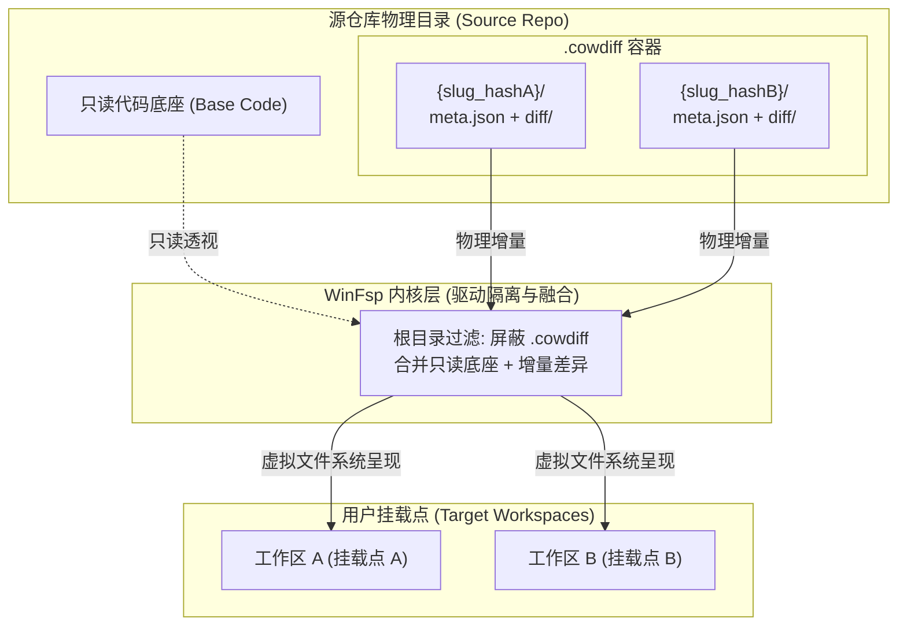

# cowlink 写时复制虚拟工作区：自完整差异存储与虚拟化架构规范

> **文档标识**：`20261022-SPEC-存储引擎-自完整差异存储与虚拟化架构.md`  
> **文档类型**：SPEC（技术规范与架构设计）  
> **所属模块**：存储引擎 (Storage Engine) & 驱动协同 (WinFsp Integration)  
> **当前状态**：PROD-READY / 已验证落地  
> **最后更新**：2026-10-22  

---

## 1. 架构目标与结论

面向 Windows 开发场景，传统多分支或多任务环境常面临“全量拷贝耗时长、磁盘占用大（数十GB）、或集中在 C 盘 AppData 撑爆系统盘”的严重痛点。

`cowlink` 基于 **WinFsp 用户态驱动** 与 **自完整写时复制（COW）变体存储体系**，实现了：
1. **秒级创建与挂载**：无论原始代码库多大（10GB+），虚拟工作区挂载耗时 < 0.5s，零初始磁盘拷贝；
2. **源内自完整变体池（`.cowdiff`）**：差异数据物理保存在被链接的源目录内部，各工作区基于路径 Hash 严格隔离，支持随源码一起打包、移动或 Git 归档；
3. **C 盘零物理占用**：彻底废弃在 `%LOCALAPPDATA%` 存储大文件差异，差异数据与源目录同盘同速；
4. **驱动级安全防穿透**：底层 WinFsp 文件系统自动屏蔽 `.cowdiff`，杜绝工作区内看到自身增量或引发重入死锁。



---

## 2. 存储拓扑与 `.cowdiff` 规范

### 2.1 物理目录层级
每个被链接的源目录根部，允许且仅允许派生一个 `.cowdiff` 目录：
```text
E:\repo_root\
├── src/                          # 原始源码（只读底座，0 污染）
├── package.json
└── .cowdiff/                     # 变体存储容器（支持单源多工作区）
    ├── ws_feature_a_4f92c10a/    # 工作区 A（Slug + PathHash）
    │   ├── meta.json             # 自完整元数据
    │   └── diff/                 # 物理增量文件层（Upper Layer）
    │       ├── modified_app.rs   # 修改文件
    │       ├── new_feature.rs    # 新增文件
    │       └── .cow_deleted.xxx  # 白颜删除标记 (Whiteout)
    └── ws_bugfix_b_9a87bf12/     # 工作区 B（独立增量）
        ├── meta.json
        └── diff/
```

### 2.2 路径哈希算法（`compute_path_hash`）
为了兼顾“人类在文件系统中一眼识别”与“跨盘符/同名路径绝对唯一性”，采用以下哈希策略：
1. **标准化路径**：目标路径全部转换为小写，统一斜杠为 `/`；
2. **提取标识（Slug）**：获取目标文件夹名，移除非字母数字字符（仅保留 `_` 和 `-`）；
3. **计算哈希（Short Hash）**：使用 64 位整型摘要截取低 32 位生成 8 位 Hex 字符串；
4. **拼接格式**：`<FolderSlug>_<8位Hash>`（如 `client_dev_4a91c0e3`）。

### 2.3 自完整元数据契约（`meta.json`）
位于 `.cowdiff/{pathHash}/meta.json`，确保脱机状态下依然具备完整自描述能力：
```json
{
  "version": 1,
  "source_dir": "E:\\repo_root",
  "diff_dir": "E:\\repo_root\\.cowdiff\\client_dev_4a91c0e3\\diff",
  "target_dir": "E:\\workspaces\\client_dev",
  "target_path_hash": "client_dev_4a91c0e3",
  "mode": "driver",
  "created_at": "1729567000",
  "active": true,
  "pid": 28412
}
```

### 2.4 全局注册表双写与跨机同步
- **本机快速索引**：在 `%LOCALAPPDATA%\cowlink\workspaces\{pathHash}\meta.json` 保持镜像索引，GUI/CLI 秒级列出全局工作区，无需递归遍历磁盘；
- **自完整真理源**：若全局索引与源目录 `.cowdiff` 发生差异，以源目录中的 `meta.json` 为准；
- **跨机自动导入（`scan_source_cowdiff`）**：当项目目录拷贝到新机器时，调用扫描接口即可一键提取 `.cowdiff` 中的变体并注册至本机全局索引。

---

## 3. 驱动级安全防线与内核交互

### 3.1 挂载点互斥与重入死锁免疫（Zero Re-entrancy）
- **原理约束**：Windows 的 NTFS 目录挂载点（Volume Mount Point / Junction）会无条件拦截挂载路径下的全部 I/O 请求。若物理 diff 存放在挂载点内部，`cowlink.exe` 写入磁盘时会被 Windows 内核再次重定向到 WinFsp 驱动自身，形成自环死锁。
- **物理隔离实现**：挂载点为用户指定的外露工作区（如 `E:\workspaces\client_dev`），而物理增量位于源目录 `.cowdiff/`。WinFsp 进程使用普通 Win32 API 读写磁盘，彻底绕过挂载点，物理 I/O 一路畅通。

### 3.2 根级驱动遮蔽（Driver-level Masking）
为了防止源目录的 `.cowdiff` 穿透呈现到虚拟工作区内，驱动在两层做了硬拦截：
1. **路径解析层（`LayerState::resolve`）**：
   凡是以 `.cowdiff` 或 `.cowlink` 开头的相对路径，无论在 Upper 还是 Lower 均直接返回 `PathResolution::NotFound`；
2. **目录遍历层（`DirectoryMerger::read_directory`）**：
   在合并 Upper 与 Lower 目录项时，根目录下的 `.cowdiff` 均跳过，禁止暴露给用户态程序（如 VS Code、Git、编译工具链）。

### 3.3 白颜标记（Whiteout）语义
- **删除处理**：当用户在工作区删除底座中存在的文件时，驱动不在只读底座执行真实删除，而是在 `diff/` 对应父目录下创建 `.cow_deleted.<filename>` 墓碑文件；
- **融合规则**：`read_directory` 遍历时优先提取所有白颜标记，并自动屏蔽底层同名文件，模拟出该文件已被删除的物理事实。

---

## 4. 桌面端应用架构 (Tauri 2.0)

应用采用 **Tauri 2.0 + 系统原生 WebView2 + 离线 Tailwind CSS** 架构：

| 模块 | 实现策略 | 效果与收益 |
| :--- | :--- | :--- |
| **内核调用链** | 纯 Win32 API (`OpenSCManagerW`, `ShellExecuteW`, `TerminateProcess`) | 彻底杜绝 cmd/powershell 黑色终端闪烁 |
| **可执行体积** | 8.38 MB (UI) + 0.96 MB (驱动核) | 纯本地单文件绿色分发，无庞大依赖 |
| **内存占用** | 运行态稳定在 ~37 MB RAM | 仅为 Electron 类应用的 1/5 |
| **UI 交互** | A+C 融合视图（工作台深度视图 + 全景数据表） | 支持快捷切换、驱动状态实时诊断、一键卸载/恢复 |

---

## 5. 关键代码映射

| 文件位置 | 核心职责 |
| :--- | :--- |
| [`modules/cowfs/src/config.rs`](file:///e:/a8-devtools/modules/cowfs/src/config.rs) | `WorkspaceMeta` 数据结构、`compute_path_hash`、双写与自完整发现逻辑 |
| [`modules/cowfs/src/cow/state.rs`](file:///e:/a8-devtools/modules/cowfs/src/cow/state.rs) | 三层路径解析状态机、`.cowdiff` 虚拟不可见拦截 |
| [`modules/cowfs/src/cow/readdir.rs`](file:///e:/a8-devtools/modules/cowfs/src/cow/readdir.rs) | 目录合并引擎、白颜标记识别、根目录静默过滤 |
| [`modules/cowfs/src/cow/copy_up.rs`](file:///e:/a8-devtools/modules/cowfs/src/cow/copy_up.rs) | 细粒度并发锁、原子 Copy-Up 写时复制文件提升引擎 |
| [`modules/devtools/src/main.rs`](file:///e:/a8-devtools/modules/devtools/src/main.rs) | Tauri 2.0 后端 Command 接口绑定（无黑窗系统调用） |
| [`modules/devtools/ui/index.html`](file:///e:/a8-devtools/modules/devtools/ui/index.html) | A+C 融合纯白高质感前端视图与 IPC 联动 |

---

## 6. 验证记录

- **测试套件**：`cargo test --test unit_test`（5 项关键测试全部 PASS）：
  - `test_cowdiff_path_hash_and_structure`：路径 Hash 与 `.cowdiff` 结构断言；
  - `test_cowdiff_isolation_and_hiding`：驱动层目录遍历与路径解析彻底遮蔽断言；
  - `test_layer_state_and_copy_up`：写时复制提升与白颜标记验证；
  - `test_workspace_meta_serialization`：双写与元数据反序列化测试。
- **发布构建**：`cargo build --release --bin cowlink --bin cowlink-ui` 零告警通过。
