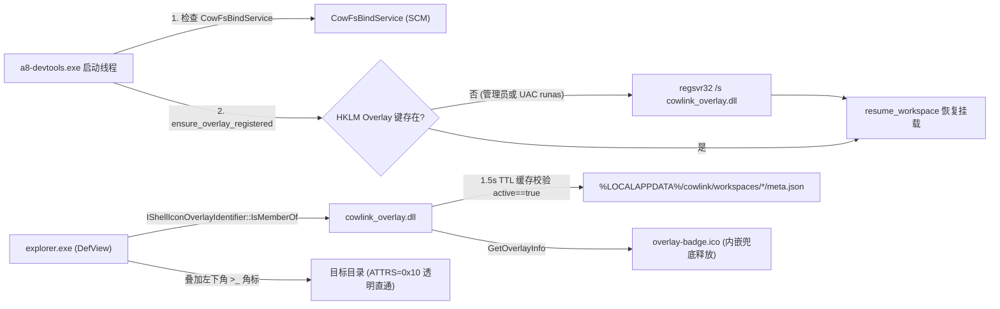

# ADR：纯直通透明映射与 Shell Icon Overlay 角标架构

- **日期**：2026-11-13
- **状态**：已实施生效
- **涉及模块**：`modules/cowfs`、`modules/cowlink_overlay`、`modules/devtools`

---

## 1. 决策结论

1. **彻底退役 `desktop.ini` + `FILE_ATTRIBUTE_READONLY` 目录伪装与 `mount_direct` 方案**：映射目标目录对上层业务软件保持 100% 透明（实测 `FindFirstFileW` 属性为纯粹 `0x00000010`、`dwReserved0=0x00000000`、`desktop.ini` 不存在）。
2. **直通模式回归纯零拷贝内核/服务桥接**：`cowfs link --direct` 统一走 `bindflt::client_bind(&target_clean, &canonical_source)`，不再经由 WinFsp 用户态中转。
3. **采用独立 COM Shell Extension（`cowlink_overlay.dll`）实现可视化角标**：通过 `IShellIconOverlayIdentifier` 在 Explorer 渲染层叠加左下角透明蓝青 `>_` 徽章（[overlay-badge.ico](file:///E:/a8-devtools/modules/devtools/icons/overlay-badge.ico)），并由 `a8-devtools.exe` 启动时自动检查并完成 `HKLM` 注册。

---

## 2. 背景与根因剖析

1. **透明性与 `desktop.ini` 的本质冲突**：
   - Windows 资源管理器仅在目录具备 `FILE_ATTRIBUTE_READONLY`（或系统属性）且内含 `desktop.ini` 时才读取自定义图标。
   - 若在直通层向根目录伪造 `READONLY` 与虚拟 `desktop.ini`，会导致部分 IDE/构建工具误判目录不可写或扫描到幽灵文件，违背“对上层完全透明”的核心诉求。
2. **Windows 10/11 Explorer Overlay 加载约束**：
   - Explorer 仅读取 `HKLM\Software\Microsoft\Windows\CurrentVersion\Explorer\ShellIconOverlayIdentifiers`（不加载 `HKCU`），且按键值字典序仅取前 15 个槽位。
   - 因此注册表键名使用 7 个前导空格（`"       A8CowFsOverlay"`）确保排在系统序列首位（实测第 `[0]` 位），避免被其他网盘/同步客户端挤出 15 槽位配额。
3. **跨机器发布与角标形态**：
   - 早期将整张完整文件夹图标直接作为 Overlay 返回，导致与系统黄色文件夹重叠；同时 `resolve_icon_path()` 硬编码了开发机路径。
   - 现改为专用透明背景左下角徽章 `overlay-badge.ico`（16~256 多尺寸），并通过 `include_bytes!` 内嵌进 `cowlink_overlay.dll`（优先读取 DLL 同目录文件，否则自动释放至 `%LOCALAPPDATA%\cowlink\overlay-badge.ico`）。

---

## 3. 架构设计与闭环流程

---

## 4. 关键实现与清理清单

- **旧代码逆向清缴**：
  - 删除 `modules/cowfs/src/cow/desktop_ini.rs`。
  - 清理 `modules/cowfs/src/cow/{mod.rs, state.rs, readdir.rs, copy_up.rs}` 与 `modules/cowfs/src/winfsp_fs/{host.rs, context.rs}` 中所有 `desktop_ini`、`direct_mode`、`new_direct`、`mount_direct`、`virtual_content` 及根目录 `READONLY` 伪装逻辑。
  - 删除 `modules/cowfs/src/bindflt.rs` 中无用的 `clear_readonly_attr`。
- **Overlay 组件（[lib.rs](file:///E:/a8-devtools/modules/cowlink_overlay/src/lib.rs)）**：
  - `OVERLAY_REG_NAME = "       A8CowFsOverlay"`，CLSID `{55F87E2C-255B-4C2E-893A-A7E004B50341}`。
  - `IsMemberOf` 先对非目录请求快速返回 `S_FALSE`（`dwattrib != 0 && (dwattrib & 0x10) == 0`），再经 1.5 秒 TTL 内存缓存比对 `meta.json` 中 `active == true` 的 `target_dir`。
  - `GetOverlayInfo` 返回内嵌或同目录的 `overlay-badge.ico`。
- **启动自检自注册（[bindflt.rs](file:///E:/a8-devtools/modules/cowfs/src/bindflt.rs#L667)、[main.rs](file:///E:/a8-devtools/modules/devtools/src/main.rs#L714)）**：
  - `ensure_overlay_registered(&cowfs_bin)` 检查 `HKLM` 注册键，缺失时调用 `regsvr32.exe /s`（非管理员自动通过 `ShellExecuteExW("runas")` 触发一次 UAC）。
  - `a8-devtools.exe` 启动线程与 `cowfs service-setup` / `cowfs link` 均调用该自检。

---

## 5. 验证记录

- `cargo test -p cowlink_overlay -p cowfs`：12 个用例全部通过（0 失败）。
- `explorer.exe` 实测已加载 `cowlink_overlay.dll`，`IShellIconOverlay::GetOverlayIndex` 对映射目录 `agent-mind` 返回有效槽位 `10`（非映射目录返回 `-1`），`FindFirstFileW` 返回 `ATTRS=0x00000010`、`RESERVED0=0x00000000`、`desktop.ini` 不存在。
