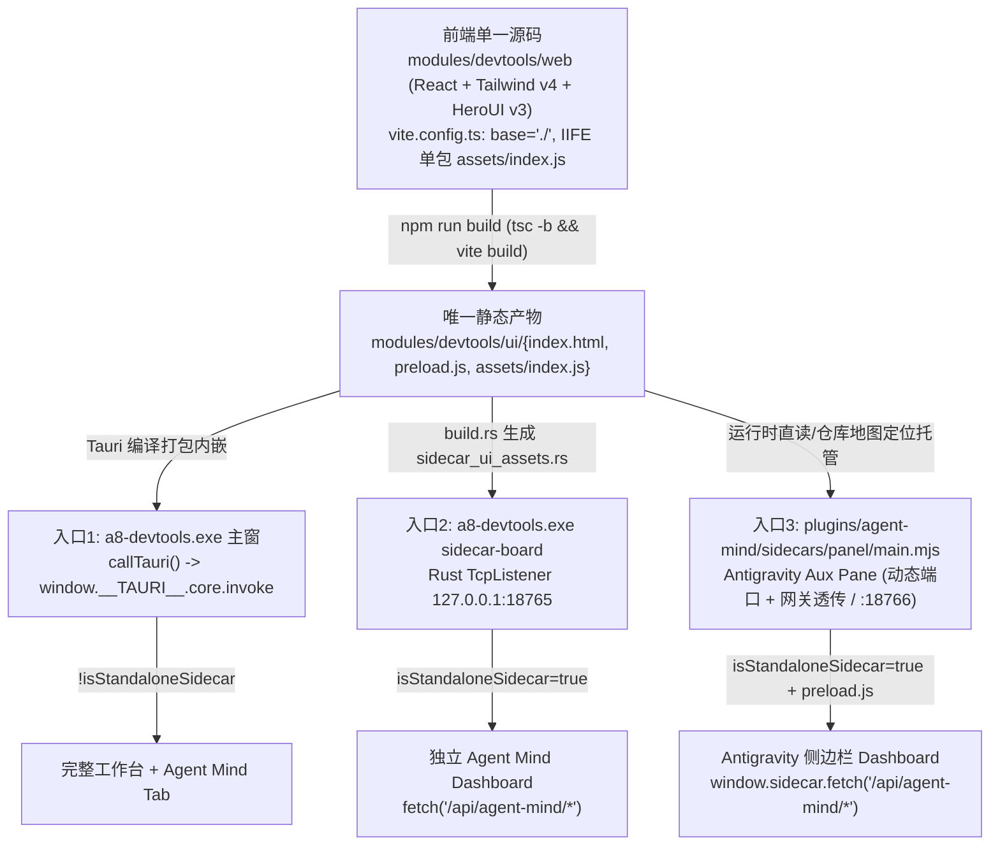

# 三端同源 Dashboard 架构、白屏根因排查与防踩坑指南

> **文档状态**：已修复并实测通过 | **适用模块**：[`modules/devtools/`](file:///e:/a8-devtools/modules/devtools/), [`plugins/agent-mind/sidecars/panel/`](file:///e:/a8-devtools/plugins/agent-mind/sidecars/panel/)
> **建档缘由**：沉淀 `a8-devtools` 桌面端、Rust `18765` 独立 Web 看板、Antigravity `agent-mind/panel` Sidecar 三端同源 Dashboard 从搭建至今经历的全部 4 类白屏故障根因与工程防线，避免后续演化再次踩坑。

---

## 1. 三端同源复用架构总览

为杜绝桌面端、独立浏览器看板与 Antigravity 插件侧边栏出现“两套 UI、两套逻辑、各自修 Bug”的双轨撕裂，全系统采用**单仓单前端产物 (`modules/devtools/ui`) + 运行时适配器**的三端同源模型：

---

## 2. 历次白屏根因全景复盘（含历史 3 坑 + 本次插件看板坑）

### 坑一：Antigravity Aux Pane 自定义协议 / 沙箱 Origin 导致静态资源返回 403（2026-11-14 插件看板白屏直接根因）

1. **物理现场**：
   - Antigravity Electron 宿主通过 `--standard-schemes=plugin,agy-favicon --cors-schemes=plugin` 加载插件 UI，或将 Aux Pane 挂载在沙箱 iframe / WebView（携带 `Origin: null`、`Origin: plugin://...`、`Origin: vscode-webview://...` 或 `Origin: antigravity-sidecar://...`）下，再透传至 `sidecars/panel/main.mjs` 的动态本地回环端口（如 `127.0.0.1:52875`）。
   - Vite 默认产出的 HTML 包含 ``，并剔除样式链接 `crossorigin`。
   - **静态资源免 Origin 拦截（[`main.mjs`](file:///e:/a8-devtools/plugins/agent-mind/sidecars/panel/main.mjs) & [`sidecar.rs`](file:///e:/a8-devtools/modules/devtools/src/sidecar.rs)）**：
     - 将非 `/api/` 的 `GET` / `HEAD` 静态资源与 `OPTIONS` 预检置于 Origin 拦截**之前**，固定下发 `Access-Control-Allow-Origin: *` 与 `Cache-Control: no-store`；
     - 仅针对 `/api/` 控制面校验 `Origin`：放行无 `Origin`、`Origin: null`、本地自定义协议（`tauri:`、`plugin:`、`vscode-webview:`、`antigravity:`、`antigravity-sidecar:`、`file:`）及 `http:`/`https:` 本机回环（`127.0.0.1`、`localhost`、`tauri.localhost`、`::1`、`[::1]`），继续以 `403` 严格拦截外部网页 Origin（如 `https://evil.example.com`）。

### 坑二：缺失 `sidecar_sdk/preload.js` 桥接、CORS 头缺 `X-Sidecar-Token` 与旧 HTML 双轨残留

1. **物理现场**：
   - Antigravity Sidecar 宿主通过查询参数 `?token=<ANTIGRAVITY_SIDECAR_UI_TOKEN>&conversationId=<id>` 向页面注入访问令牌与上下文，依赖前端首先加载 `/preload.js` 初始化 `window.sidecar.fetch`（自动注入 `X-Sidecar-Token` 并监听宿主 `theme-change` / `workspace-change` 消息）。
   - 同时，`plugins/agent-mind/sidecars/panel/` 下曾残留早期的手写单页 `index.html`（引用外链 `https://www.gstatic.com/antigravity/web/dev/tailwindcss.min.js`），与 `modules/devtools/ui` 构成双轨隐患。
2. **根治防线**：
   - [`modules/devtools/web/index.html`](file:///e:/a8-devtools/modules/devtools/web/index.html) 在主脚本前加载 ``，并由 [`public/preload.js`](file:///e:/a8-devtools/modules/devtools/web/public/preload.js) 提供非 Antigravity 宿主环境下的静默兜底（避免 404）；
   - [`main.mjs`](file:///e:/a8-devtools/plugins/agent-mind/sidecars/panel/main.mjs) 中的 `resolvePreloadJs()` 优先读取宿主 `sidecar_sdk/preload.js` 并托管为 `/preload.js`；
   - [`App.tsx`](file:///e:/a8-devtools/modules/devtools/web/src/App.tsx) 的 `callTauri` 控制面请求优先通过 `window.sidecar.fetch` 发送，且服务端 `Access-Control-Allow-Headers` 放行 `Content-Type, X-Sidecar-Token`；
   - 彻底删除遗留 `plugins/agent-mind/sidecars/panel/index.html` 双轨死文件，当构建产物缺失时直接返回 `503` 提示，遵循单仓单一实现路径红线。

### 坑三：Vite 缺失相对基础路径 `base: './'`（2026-11-12/13 历史踩坑）

1. **物理现场**：Vite 默认 `base: '/'` 会生成 `` 与 ``。
2. **Origin 与静态资源校验**：向运行中的 Sidecar 端口分别以 `无 Origin`、`Origin: null`、`Origin: plugin://agent-mind`、`Origin: vscode-webview://123` 请求 `/`、`/preload.js`、`/assets/index.js`、`/api/agent-mind/overview`，均须返回 `200 OK`；以 `Origin: https://evil.example.com` 请求 `/api/agent-mind/overview` 须返回 `403`。
3. **无头 DOM 渲染断言**：使用本机 Edge `--headless --virtual-time-budget=4000 --dump-dom` 请求 Sidecar URL，断言渲染后 DOM 包含 `Agent Mind Dashboard` 与 `<style>` 注入样式且无 `RootErrorBoundary` 异常界面。
4. **Rust 与 Sidecar 进程重启**：若 `main.mjs` 已更新，必须重启仍在运行旧代码的插件 Sidecar 进程（`sidecar.json` `restart_policy: "always"` 将由 `language_server` 自动拉起，可查看 `%USERPROFILE%\.gemini\antigravity\sidecar_data\agent-mind\panel\logs\sidecar.log` 确认新端口）；若 `ui/` 或 `sidecar.rs` 已更新，必须重编 `cargo test --workspace` 与 `cargo build --release -p devtools`。
