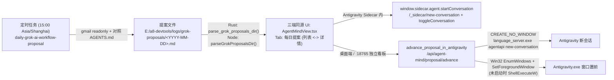

# Grok 每日 AI 提案面板与 Antigravity 联动契约 (`SPEC`)

> **文档状态**：已实现并通过编译与单测 | **适用模块**：[`modules/devtools/`](file:///e:/a8-devtools/modules/devtools/), [`plugins/a8-agent-mind/sidecars/panel/`](file:///e:/a8-devtools/plugins/a8-agent-mind/sidecars/panel/)
> **建档缘由**：规约每日定时任务 `daily-grok-ai-workflow-proposal` 产出的 `logs/grok-proposals/<YYYY-MM-DD>.md` 持久化格式、三端同源看板（桌面端、Rust `:18765`、Antigravity Sidecar）的解析/管理接口契约，以及「回到 Antigravity 推进提案」的零黑窗跨端会话拉起链路。

---

## 1. 结论与全链路闭环概览

每日 15:00（`CRON_TZ=Asia/Shanghai`）由 Antigravity 定时自动化从 Gmail 拉取 Grok 最新 AI 资讯（遇到长篇 HTML/VML 排版邮件时先经 [`strip_html_text.py`](file:///e:/a8-devtools/plugins/a8-agent-mind/scripts/strip_html_text.py) 清洗降噪）并生成针对 `a8-devtools` 的工作流提升提案，写入 `logs/grok-proposals/<YYYY-MM-DD>.md`（随 `logs/*` 纳入 `.gitignore`，不污染 `docs/` 长期索引）。用户在三端同源的 **A8 Agent Mind → 每日提案** 视图查看报告后，可一键创建带上下文的 Antigravity 新会话并唤醒客户端窗口推进落地。

---

## 2. 提案文件存储与 Frontmatter 契约

- **存储位置**：`<a8-devtools_root>/logs/grok-proposals/<YYYY-MM-DD>.md`
  - 仓库根目录解析顺序（`resolve_devtools_repo_root` / `resolveDevtoolsRepoRoot`）：
    1. `plugin_root/../..`（当包含 `Cargo.toml` 与 `modules/devtools/` 时）；
    2. `repos.md` 中 `code == "a8-devtools"` 对应的 `physical_path`；
    3. 当前可执行文件祖先目录 / 当前工作目录；
    4. 兜底路径 `E:\a8-devtools`。
- **YAML Frontmatter 字段约定**（解析器兼容无 Frontmatter 的纯 Markdown，缺失时从文件名与正文 `#` 标题/首段/`### 提案` 自动推断）：

| 字段 | 类型 | 说明 | 默认/回退规则 |
| :--- | :--- | :--- | :--- |
| `date` | `string` | 提案日期（`YYYY-MM-DD`） | 从文件名前 10 位提取 |
| `title` | `string` | 提案总标题 | 正文首个 Markdown 标题或文件名 stem |
| `source_subject` | `string` | 来源 Grok 邮件主题 | 空字符串 |
| `source_date` | `string` | 来源邮件时间 | 空字符串 |
| `proposal_count` | `number` | 提案条数 | 统计 `## 提案` / `### 提案` 或 `### ` 标题数 |
| `status` | `enum` | `pending` / `in_progress` / `adopted` / `dismissed` | 默认 `pending` |
| `summary` | `string` | 一句话精炼摘要 | 正文首段前 180 字符 |

---

## 3. 三端同源控制面与安全边界

### 3.1 统一路由与 Tauri 命令映射

| 能力 | Tauri Command (`agent_mind.rs`) | HTTP 路由 (`sidecar.rs` & `main.mjs`) | 入参 / 返参 |
| :--- | :--- | :--- | :--- |
| 总览加载 | `get_agent_mind_overview` | `GET /api/agent-mind/overview` | 附带 `proposals: GrokProposalRecordDto[]`、`proposals_dir` 与 `telemetry: HarnessTelemetryDto` |
| 读取正文 | `read_grok_proposal` | `POST /api/agent-mind/proposal/read` | `{ file_name }` → `string` |
| 更新状态 | `update_grok_proposal_status` | `POST /api/agent-mind/proposal/status` | `{ file_name, status }`（仅允许 `pending` / `in_progress` / `adopted` / `dismissed`）写入 Frontmatter 并返还最新状态 |
| 删除提案 | `delete_grok_proposal` | `POST /api/agent-mind/proposal/delete` | `{ file_name }` → `null` |
| 打开目录 | `open_grok_proposals_dir` | `POST /api/agent-mind/proposal/open-dir` | 自动建目录并用系统文件管理器打开 |
| 回到 Antigravity 推进 | `advance_proposal_in_antigravity` | `POST /api/agent-mind/proposal/advance` | `{ file_name, title?, prompt? }` → `AdvanceProposalResultDto`（若原状态为 `pending` 自动流转为 `in_progress`） |

### 3.2 安全校验红线

- **单段文件名边界（`resolve_safe_proposal_file` / `resolveSafeProposalFile`）**：严格拒绝包含 `/`、`\`、`:`、`..`、`~`、`\0` 或尾随 `.`/空格 的输入，仅允许 `.md` 后缀，并通过 `canonicalize` / `realpathSync` 断言目标位于 `logs/grok-proposals` 目录内。
- **Sidecar 宿主桥接鉴权（`main.mjs`）**：`/_sidecar/new-conversation` 与 `/_sidecar/get-conversation-metadata` 在环境变量 `ANTIGRAVITY_SIDECAR_UI_TOKEN` 存在时强制校验请求头 `X-Sidecar-Token`。

---

## 4. 「回到 Antigravity 推进」执行与窗口唤醒策略

1. **Antigravity Sidecar 宿主页内（`hasHostBridge` 为真）**：前端直接调用 `window.sidecar.agent.startConversation(convPrompt, convTitle)`，解析返回 `conversationId` 后调用 `window.sidecar.ui.toggleConversation(convId)` 在当前窗口切入新会话；不静默吞掉宿主桥接异常。
2. **桌面端（`a8-devtools.exe`）与独立浏览器看板（`:18765`）**：
   - 定位 `ANTIGRAVITY_AGENTAPI_EXE` 或 `%LOCALAPPDATA%\Programs\Antigravity\resources\bin\language_server.exe`；
   - **Hub 服务自动发现**：脱离 Antigravity Sidecar 宿主环境运行时（进程缺少 `ANTIGRAVITY_LS_ADDRESS` / `ANTIGRAVITY_CSRF_TOKEN`），自动扫描 `%USERPROFILE%\.gemini\antigravity\daemon\hub_*.json`（按 mtime 倒序），通过原生 Win32 `OpenProcess` + `GetExitCodeProcess` + `QueryFullProcessImageNameW`（校验 `language_server.exe` 存活，零 `cmd`/`powershell` 黑窗）及本地端口 `127.0.0.1:<httpPort>` TCP 连通性探活，自动注入 `ANTIGRAVITY_LS_ADDRESS=http://127.0.0.1:<httpPort>` 与 `ANTIGRAVITY_CSRF_TOKEN=<csrfToken>`；
   - 以 `CREATE_NO_WINDOW`（`0x08000000`）直接执行 `language_server.exe agentapi new-conversation --title <conv_title> <conv_prompt>`（严禁经过 `cmd.exe` / `.bat` 垫片，杜绝黑窗闪烁）；
   - 通过 Win32 `EnumWindows` 传入局部 `LPARAM(&mut found)`（无全局静态变量竞态）检索可见 `Antigravity.exe` 窗口，命中后执行 `ShowWindow(SW_RESTORE)` + `SetForegroundWindow` 置前；若客户端未运行则通过 `ShellExecuteW` 启动 `Antigravity.exe`。

---

## 5. 交卷验证记录

- **前端**：`npx tsc --noEmit` 与 `npm run build`（`tsc -b && vite build`）通过，产物 [index.html](file:///e:/a8-devtools/modules/devtools/ui/index.html) 无 `type="module"` 或 `crossorigin`。
- **Rust 工作区**：`cargo test --workspace` 24 项全绿（含 `test_parse_and_manage_grok_proposals`、`test_parse_harness_telemetry_and_proposal_status` 与 `test_discover_ls_from_daemon_dir_picks_live_hub`），`cargo check --workspace` 与 `cargo build --release -p devtools` 零错误通过。
- **插件 Sidecar 与 Python**：`node --check main.mjs` 与临时端口 `GET /api/agent-mind/overview` 实测通过（返回 `telemetry.daily_trends` 14 日数组与 `proposals`）；`py_compile` 与隔离 `PLUGIN_DATA` 遥测单测通过。
