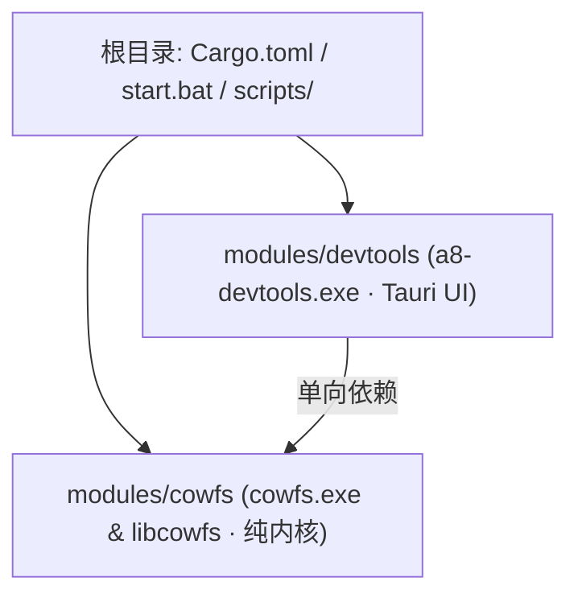

# ADR：a8-devtools 多模块工作台与 cowfs 集成架构演进

- **日期**：2026-10-22
- **状态**：已落地（当时有效）
- **域**：platform-and-storage.md
- **取代**：无

---

## 1. 问题与目标

- **要解决的问题**：项目最初仅定位为单一虚拟文件系统工具 `cowlink`；随着研发场景扩展，Windows 开发者高频需要同时维护 `etc/hosts`、诊断系统驱动与桌面端面板，单一工具形态导致工具链碎片化与心智负担。
- **设计目标**：将工程重构为 `a8-devtools` 多模块 Cargo Workspace 工作台，在目录与依赖上彻底解耦底层文件系统内核与上层桌面 GUI，为后续接入更多开发工具模块预留单一清晰扩展口。

## 2. 核心设计与结论

1. **Cargo Workspace 多模块拓扑**：根目录 `Cargo.toml`（`resolver = "2"`）隔离管理 `modules/cowfs`（后增 `modules/cowlink_overlay` 见 [20261113 ADR](20261113-ADR-存储与桌面集成-纯直通透明映射与ShellOverlay角标架构.md)）与 `modules/devtools`，依赖方向严格为 `devtools -> cowfs` 单向依赖。
2. **模块职责切分**：
   - **`modules/cowfs`**：纯系统级存储库（`libcowfs`）与轻量 CLI（`cowfs.exe`），零前端/Tauri/RFD 依赖，承载 WinFsp 驱动宿主、COW 状态机、原子 Copy-Up 与 `.cowdiff` 源内自完整存储。
   - **`modules/devtools`**：Tauri 2.0 桌面工作台应用（`a8-devtools.exe`），承载 CowFS 工作区视图、`etc/hosts` 编辑器与系统/驱动健康诊断，并通过 `modules/` 平铺接入后续模块。
3. **关键重构映射**：原单仓 `src/cow/` + `src/winfsp_fs/` 迁入 `modules/cowfs/src/`、`src/gui_main.rs` 迁入 `modules/devtools/src/main.rs`、`install_driver.*` 收拢至 `scripts/`、`start_gui.bat` 规范化为根目录 `start.bat`。

## 3. 当时验证范围

- **2026-10-22 重构验证**：`cargo test -p cowfs` 核心单元测试通过，工作区编译生成绿色轻量产物（`a8-devtools.exe` ~8.4 MB、`cowfs.exe` ~0.9 MB），空闲运行内存 ~37 MB。

## 4. 对常青文档的影响

- 多模块 Workspace 分层与单向依赖边界已沉淀至 [platform-and-storage.md](../evergreen/platform-and-storage.md)；随演进新增的 `modules/cowlink_overlay` 与 `plugins/a8-agent-mind` 均遵循本 ADR 确立的边界约束。
