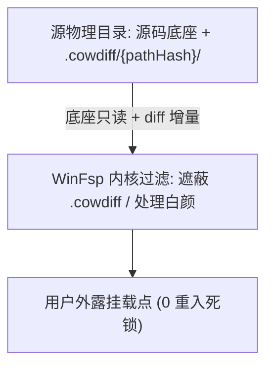

# SPEC：自完整差异存储（.cowdiff）与 WinFsp 虚拟化架构

- **日期**：2026-10-22
- **状态**：部分失效（被 20261113-ADR-存储与桌面集成-纯直通透明映射与ShellOverlay角标架构.md 更新）
- **域**：platform-and-storage.md
- **取代**：无

> **[部分失效（2026-11-20 补标）]**
> 本文第 1～3 部分的 `.cowdiff` 源内自完整布局、路径哈希、重入免疫与 WinFsp 白颜（Whiteout）机制持续有效；文末原“直通模式桌面图标伪装”及早期的 `cowlink-ui` 二进制命名，已分别被 [20261113 ADR](20261113-ADR-存储与桌面集成-纯直通透明映射与ShellOverlay角标架构.md)（纯 `bindflt` 直通 + `cowlink_overlay.dll`）与 [20261022 ADR](20261022-ADR-架构演进-a8-devtools多模块工作台与cowfs集成.md) 取代更新。

---

## 1. 问题与目标

- **要解决的问题**：多分支并行开发若采用仓库全量拷贝耗时且耗盘，而把增量差异集中存在系统盘 `%LOCALAPPDATA%` 又会撑爆 C 盘并丢失项目自包含可迁移性。
- **设计目标**：依托 WinFsp 用户态驱动实现秒级无拷贝挂载（< 0.5s），并将增量物理存储在源目录内部 `.cowdiff` 中，同时在驱动层彻底免疫重入死锁。

## 2. 核心设计与结论

1. **`.cowdiff/{pathHash}` 源内自完整存储拓扑**：
   - 每个源目录根部存放独立变体容器 `.cowdiff/<FolderSlug>_<8位HexHash>/`，内含 `meta.json`（`version`、`source_dir`、`diff_dir`、`target_dir`、`mode` 等自描述字段）与 `diff/`（Upper 层）；
   - `compute_path_hash` 将目标路径标准化小写、提取目录名 Slug 并对 64 位整型摘要取低 32 位 Hex，保证人类可读且跨盘符唯一；
   - `%LOCALAPPDATA%\cowlink\workspaces\{pathHash}\meta.json` 仅作本机快速列表索引，冲突时以源目录 `.cowdiff` 为真源并支持 `scan_source_cowdiff` 跨机自动恢复。
2. **驱动隔离与重入死锁免疫（Zero Re-entrancy）**：
   - 物理 Upper 差异层绝不位于用户挂载点内部，WinFsp 进程通过普通 Win32 API 直接读写源目录 `.cowdiff/`，绕开内核重定向，从根源消除自环死锁；
   - **根级遮蔽**：在路径解析层（`LayerState::resolve`）与目录遍历层（`DirectoryMerger::read_directory`）双重静默过滤 `.cowdiff` 与 `.cowlink`（直接返回 `NotFound` / 跳过条目），防止工作区透视自身增量。
3. **白颜删除（Whiteout）语义**：删除底座文件时不触碰只读源码，而在 `diff/` 对应父目录写 `.cow_deleted.<filename>` 墓碑标记，合并遍历时提取标记屏蔽底层同名条目。
4. **桌面壳层（当时实现）**：采用 Tauri 2.0 + 纯 Win32 API（`OpenSCManagerW`、`ShellExecuteW`、`TerminateProcess`）避免 `cmd`/`powershell` 黑窗闪烁。

## 3. 当时验证范围

- **2026-10-22 验证**：`cargo test --test unit_test` 核心测试全过（涵盖 `test_cowdiff_path_hash_and_structure`、`test_cowdiff_isolation_and_hiding`、`test_layer_state_and_copy_up`、`test_workspace_meta_serialization`）；当时发布构建 `cargo build --release --bin cowlink --bin cowlink-ui` 零告警通过。

## 4. 对常青文档的影响

- `.cowdiff` 布局、路径哈希算法、重入免疫与白颜契约已沉淀至 [platform-and-storage.md](../evergreen/platform-and-storage.md)；直通模式已按 2026-11-13 ADR 更新为 `bindflt` + Shell Overlay。
