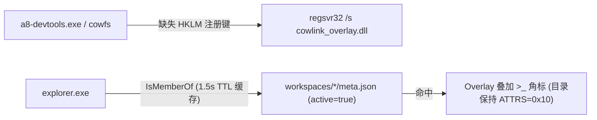

# ADR：纯直通透明映射与 Shell Icon Overlay 角标架构

- **日期**：2026-11-13
- **状态**：已落地（当时有效）
- **域**：platform-and-storage.md
- **取代**：20261022-SPEC-存储引擎-自完整差异存储与虚拟化架构.md（第 4 节原直通伪装方案）

---

## 1. 问题与目标

- **要解决的问题**：早期直通模式为让 Windows 资源管理器显示图标而注入 `FILE_ATTRIBUTE_READONLY` 与虚拟 `desktop.ini`（`mount_direct`），导致 IDE、Git 或构建工具误判目录只读或扫描到多余的隐藏文件，破坏目录透明性；同时早期文件夹图标硬编码开发机路径。
- **设计目标**：彻底清除 `desktop.ini` 目录伪装，回归纯 `bindflt` 零拷贝内核直通，并采用独立 Explorer COM Shell Icon Overlay 扩展实现无侵入角标及跨机器自动注册。

## 2. 核心设计与结论

1. **彻底退役 `desktop.ini` + `READONLY` 伪装**：逆向清缴 `modules/cowfs/src/cow/desktop_ini.rs` 及所有 `mount_direct` / `virtual_content` / `clear_readonly_attr` 分支；`cowfs link --direct` 统一直连 `bindflt::client_bind`，目标目录属性保持纯正 `ATTRS=0x00000010`、`dwReserved0=0x00000000`。
2. **独立 COM Overlay 扩展（`cowlink_overlay.dll`）**：
   - 实现 `IShellIconOverlayIdentifier`，CLSID `{55F87E2C-255B-4C2E-893A-A7E004B50341}`，注册键名使用 7 个前导空格（`"       A8CowFsOverlay"`）确保在 `HKLM\...\ShellIconOverlayIdentifiers` 15 槽位配额中排位靠前（实测不受 HKCU 忽略与挤占）；
   - `IsMemberOf` 先过滤非目录请求，再结合 **1.5s TTL 内存缓存**比对 `%LOCALAPPDATA%/cowlink/workspaces/*/meta.json` 中 `active == true` 的 `target_dir`；
   - `GetOverlayInfo` 叠加左下角透明蓝青 `>_` 徽章 `overlay-badge.ico`（`include_bytes!` 内嵌并在必要时自动释放至 `%LOCALAPPDATA%\cowlink\`）。
3. **启动自检自注册**：`a8-devtools.exe` 启动线程、`cowfs service-setup` 与 `cowfs link` 统一调用 `ensure_overlay_registered`，缺失 `HKLM` 注册键时执行 `regsvr32.exe /s`（非管理员自动 `ShellExecuteExW("runas")` 请求一次 UAC）。

## 3. 当时验证范围

- **2026-11-13 实测与单测**：`cargo test -p cowlink_overlay -p cowfs` 12 个用例全部通过；`explorer.exe` 实测已加载 `cowlink_overlay.dll`，`GetOverlayIndex` 对映射目录返回有效槽位 `10`（非映射目录 `-1`），`FindFirstFileW` 验证目标目录属性为 `0x00000010` 且无 `desktop.ini`。

## 4. 对常青文档的影响

- 本决策架构与清理边界已完整沉淀至 [platform-and-storage.md](../evergreen/platform-and-storage.md)，并据此将 [20261022 SPEC](20261022-SPEC-存储引擎-自完整差异存储与虚拟化架构.md) 标为部分失效。
