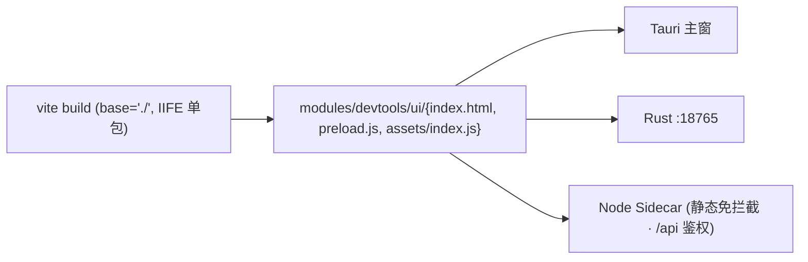

# BUG：三端同源 Dashboard 白屏根因剖析与防踩坑指南

- **日期**：2026-11-14
- **状态**：已落地（当时有效）
- **域**：dashboard-and-workflows.md
- **取代**：无

---

## 1. 问题与目标

- **要解决的问题**：桌面端、`18765` Rust 看板与 `a8-agent-mind` 插件 Antigravity Sidecar 复用同一份前端静态产物后，在 Sidecar WebView、自定义协议宿主与离线 WebView2 环境下先后暴露 4 类 100% 白屏故障，且曾残留旧版手写 `sidecars/panel/index.html` 独立副本。
- **设计目标**：根治三端静态资源拒载、协议跨域 403、缺失宿主预加载桥接与渲染异常吞没问题，确立单一 `modules/devtools/ui` 构建产物与三端无差别运行不变量。

## 2. 核心设计与结论

1. **经典单包 IIFE 构建（防 custom-scheme + CORS 403）**：
   - Antigravity Aux Pane 以自定义协议/沙箱 Origin（`Origin: null`、`plugin://`、`vscode-webview://`、`antigravity-sidecar://`）请求本地 Sidecar；Vite 默认 `<script type="module" crossorigin>` 与 Hash 命名文件会在长驻 Node Sidecar 间引发 CORS 拦截或 404。
   - `vite.config.ts` 固定 `base: './'`、`format: 'iife'`、`inlineDynamicImports: true`、无 Hash 出口 `assets/index.js`（内联 CSS），并通过 `classicSidecarHtmlPlugin()` 移除 `type="module"` 与 `crossorigin`。
2. **静态资源免 Origin 拦截与 `/api/` 安全边界**：
   - `main.mjs` 与 `sidecar.rs` 将非 `/api/` 的 `GET` / `HEAD` 静态资源与 `OPTIONS` 置于 Origin 检查之前（`Cache-Control: no-store`）；
   - 仅 `/api/` 接口校验 `Origin`：放行无 `Origin`、`Origin: null`、本地自定义协议与本机回环，对外部网页 Origin 返回 `403`，CORS 放行 `X-Sidecar-Token`。
3. **`preload.js` 桥接与单一 UI 产物源**：
   - `index.html` 先于主脚本加载 `./preload.js`（`main.mjs` 优先托管宿主 `sidecar_sdk/preload.js`，非宿主环境回退静默兜底 `public/preload.js`）；删除遗留 `sidecars/panel/index.html` 独立副本。
4. **渲染错误边界与独立模式判定**：
   - `main.tsx` 包裹 `RootErrorBoundary`、禁用会触发运行时崩溃的 HeroUI v2 扁平属性；`App.tsx` 通过 `isStandaloneSidecar` 隔离桌面端轮询。

## 3. 当时验证范围

- **2026-11-14 实测清单**：验证 `../ui/index.html` 不含 `type="module"` 与 `crossorigin`；模拟 `Origin: null` / `plugin://a8-agent-mind` / `vscode-webview://123` 访问静态资源与 `/api/agent-mind/overview` 返回 `200 OK`、`Origin: https://evil.example.com` 返回 `403`；Edge `--headless --dump-dom` 实测渲染正常。

## 4. 对常青文档的影响

- 三端 IIFE 打包与 Origin/Token 边界不变量已完整沉淀至 [dashboard-and-workflows.md](../evergreen/dashboard-and-workflows.md)。
