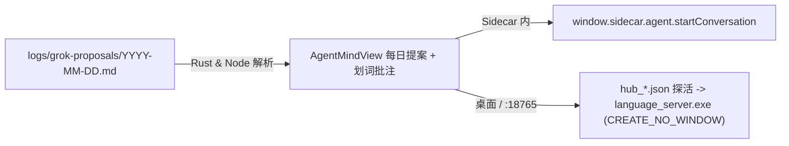

# SPEC：Grok 每日 AI 提案面板与 Antigravity 联动契约

- **日期**：2026-11-15
- **状态**：已落地（当时有效）
- **域**：dashboard-and-workflows.md
- **取代**：无

---

## 1. 问题与目标

- **要解决的问题**：每日定时生成的 Grok AI 工作流改进提案（`logs/grok-proposals/<YYYY-MM-DD>.md`）分散在本地日志目录，缺少统一三端浏览、划词审阅批注、状态流转以及一键拉起 Antigravity 会话继续推进的闭环链路。
- **设计目标**：确立提案 Frontmatter 存储契约、Rust / Node 双端同构控制面路由、划词批注持久化与零黑窗 `language_server` 会话唤醒通道。

## 2. 核心设计与结论

1. **存储与 Frontmatter 契约**：
   - 存放于 `<a8-devtools_root>/logs/grok-proposals/<YYYY-MM-DD>.md`（邮件先经 `strip_html_text.py` 去噪）；根目录按 `plugin_root/../..` -> `repos.md` `a8-devtools` -> 可执行祖先 -> `E:\a8-devtools` 顺序解析；
   - Frontmatter 字段包含 `date`、`title`、`source_subject`、`source_date`、`proposal_count`、`status`（`pending` / `in_progress` / `adopted` / `dismissed`）与 `summary`，缺失时从正文自动推断。
2. **三端同源控制面与安全边界**：
   - 统一提供 `read_grok_proposal`、`update_grok_proposal_status`、`delete_grok_proposal`、`open_grok_proposals_dir`、`advance_proposal_in_antigravity`（HTTP 对应 `/api/agent-mind/proposal/*`）与总览 `proposals` 字段；
   - `resolve_safe_proposal_file` / `resolveSafeProposalFile` 严格限制单段 `.md` 文件名（禁 `/`、`\`、`:`、`..`、`~`、`\0`）并做真实路径包含断言；Sidecar `/_sidecar/*` 接口强制校验 `X-Sidecar-Token`。
3. **划词批注与零黑窗 Antigravity 会话拉起**：
   - `ProposalDetailAnnotator.tsx` 支持划选正文添加 `批注` / `划删` / `替换` 标记并保存至 `localStorage`（`a8_proposal_annotations_v1:<file_name>`），`buildProposalAdvancePrompt` 在推进时注入全部意见；
   - Antigravity Sidecar 内直调 `window.sidecar.agent.startConversation` + `toggleConversation`；桌面端与 `:18765` 看板则扫描 `hub_*.json` 并用 Win32 `OpenProcess` / `QueryFullProcessImageNameW` + 本地 TCP 探活注入 `ANTIGRAVITY_LS_ADDRESS` / `CSRF_TOKEN`，以 `CREATE_NO_WINDOW`（`0x08000000`）调 `language_server.exe agentapi new-conversation`，再经局部 `EnumWindows` `SetForegroundWindow` 置前（原 `pending` 自动转为 `in_progress`）。

## 3. 当时验证范围

- **2026-11-15 验证**：前端 `tsc --noEmit` 与 `npm run build` 通过；`cargo test --workspace` 24 项全绿（含 `test_parse_and_manage_grok_proposals`、`test_discover_ls_from_daemon_dir_picks_live_hub`）；Sidecar `node --check main.mjs` 与 `GET /api/agent-mind/overview` 实测通过；`py_compile` 与遥测单测通过。

## 4. 对常青文档的影响

- 本契约全部接口、批注机制与零黑窗唤醒边界已完整沉淀至 [dashboard-and-workflows.md](../evergreen/dashboard-and-workflows.md)。
