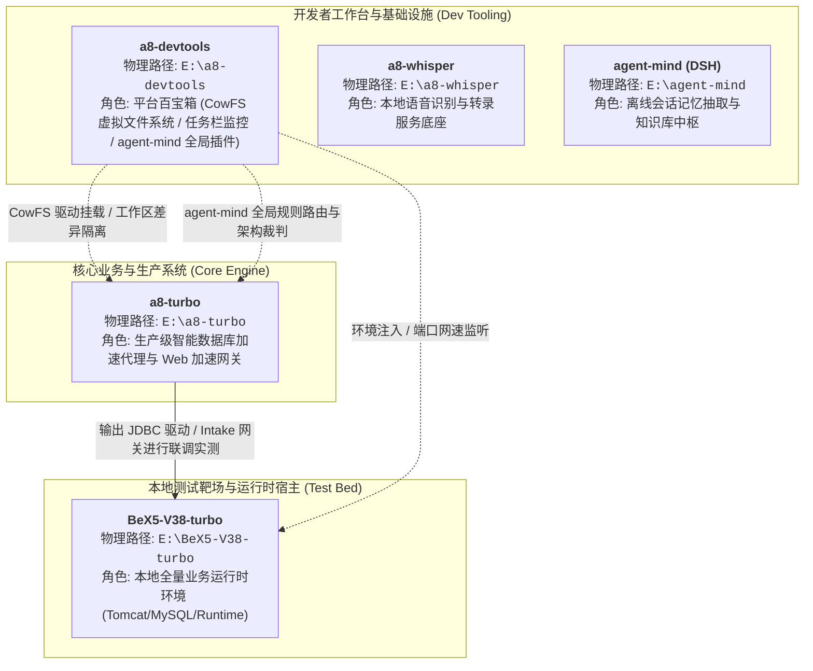

# 宿主机跨项目拓扑大地图 (Machine Project Map)

> **全局定位**：本文件是当前宿主机（Windows 开发机）所有工程项目的全局生态大地图。
> **核心作用**：指导 Agent 建立跨项目的宏观生态视角，明确各个项目的物理路径、定位角色（核心/工具/测试靶场）与依赖关系，**坚决杜绝“在单工作区内迷失”、“改错项目”、“把测试靶场当成核心源码”等致命身份混淆**。

---

## 一、 本机项目生态全景图 (Ecosystem Architecture)

---

## 二、 核心项目清单与生态角色 (Project Roster)

| 项目代号 | 物理绝对路径 | 生态位角色 (Role) | 核心定位与技术底座 | 关键交卷/构建门禁 |
| :--- | :--- | :--- | :--- | :--- |
| **a8-turbo** | `E:\a8-turbo` | **核心生产 (Core)** | **A8 智能数据库代理加速系统与前端加速网关**。 包含数据加速（`turbo-server` / `turbo-cache` / DuckDB 强类型）、客户端透明驱动（`turbo-jdbc-driver`）、Web 加速（`intake`）及控制台（`ui`）。三进程独立交付。 | 后端 Maven 编译 (`mvn compile`)；前端极速 Lint (`npx oxlint`)。 |
| **a8-devtools** | `E:\a8-devtools` | **辅助工具 (Tooling)** | **面向 Windows 的现代开发者底座平台**。 集成自主研发的 WinFsp 写时复制文件系统（`cowfs`，C盘零占用）、任务栏实时网速悬浮条、注册表开机自启，以及全局架构裁判插件 `agent-mind`。 | `cargo check --manifest-path Cargo.toml` 100% 编译通过。 |
| **BeX5-V38-turbo** | `E:\BeX5-V38-turbo` | **测试靶场 (Test-Bed)** | **大型业务运行时测试环境**。 内置 Tomcat、MySQL、Nginx、ActiveMQ 及完整的应用模型库。用于部署 A8 驱动和网关，进行真实业务压测与缓存数据对拍验证。 | **纯测试环境**：严禁作为源码直接修改提交！ |
| **a8-whisper** | `E:\a8-whisper` | **辅助工具 (Tooling)** | **语音交互与识别服务底座**。 提供本地轻量级语音转文字与语音对话支持。 | 独立运行与服务可用。 |
| **agent-mind** | `E:\agent-mind` | **参考/中枢 (Reference)** | **DeepSeek Harness 架构下的 AI 记忆抽取与知识库中枢**。 提供基于 `session.v4.jsonl.zstd` 的离线抽取管线、只读知识库结构与可视化决策面板。 | `node validate.js --strict` |

---

## 三、 跨项目协作与交互契约 (Inter-Project Workflows)

### 1. `a8-devtools` 如何为 `a8-turbo` 服务？
- **文件系统虚拟化隔离 (CowFS)**：通过 `modules/cowfs` 驱动挂载，为 `a8-turbo` 的复杂多分支或临时构建提供零 C 盘占用的 Copy-On-Write 差异层；
- **全局架构治理 (agent-mind)**：`a8-devtools/plugins/agent-mind` 通过符号链接安装到全局插件目录，为 `a8-turbo` 等项目提供统一的代码主人翁心智、红线审查与文档规范。

### 2. `a8-turbo` 如何与 `BeX5-V38-turbo` 联动？
- **透明代理测试**：`a8-turbo` 编译出的客户端无侵入驱动（`turbo-jdbc-driver.jar`）部署至 `BeX5-V38-turbo` 的应用依赖中，代理对底层 MySQL 的真实查询；
- **物理事实真源**：BeX5 中的业务数据和真实表结构作为源库，用于验证 `a8-turbo` 中本地 DuckDB 副本的 Schema 强类型对齐（严禁退化为 VARCHAR）。

---

## 四、 Agent 跨项目行为操作红线 (Cross-Project Redlines)

1. **绝对禁止修改测试靶场源码 (Zero Modifying Test-Beds)**：
   - 当任务在 `a8-turbo` 中执行时，若需要借助 `BeX5-V38-turbo` 验证，**严禁在 BeX5 内部修改业务代码来配合 turbo**；
   - 验证必须是**外部无侵入式驱动替换与配置挂载**，保持测试靶场的客观真实性。

2. **严格单向依赖与职责隔离**：
   - `a8-devtools` 是工具平台，严禁反向依赖上层业务系统 `a8-turbo` 的业务模型；
   - `a8-turbo` 是通用数据面，严禁把依赖特定本地宿主操作系统的非通用工具代码硬编码进 turbo 核心引擎。

3. **跨项目协同必须明确物理第一现场**：
   - 切换项目排查问题时，Agent 必须显式声明当前操作的物理工作区（例如：“当前切入 `E:\a8-turbo` 确认驱动编译产物，准备分发至 `E:\BeX5-V38-turbo` 进行联调”）。
